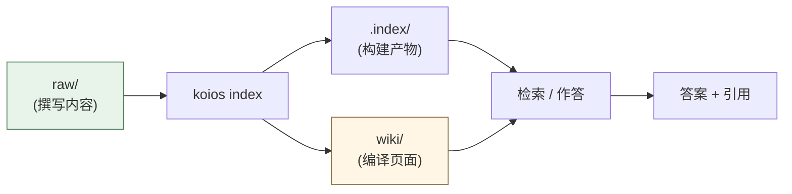
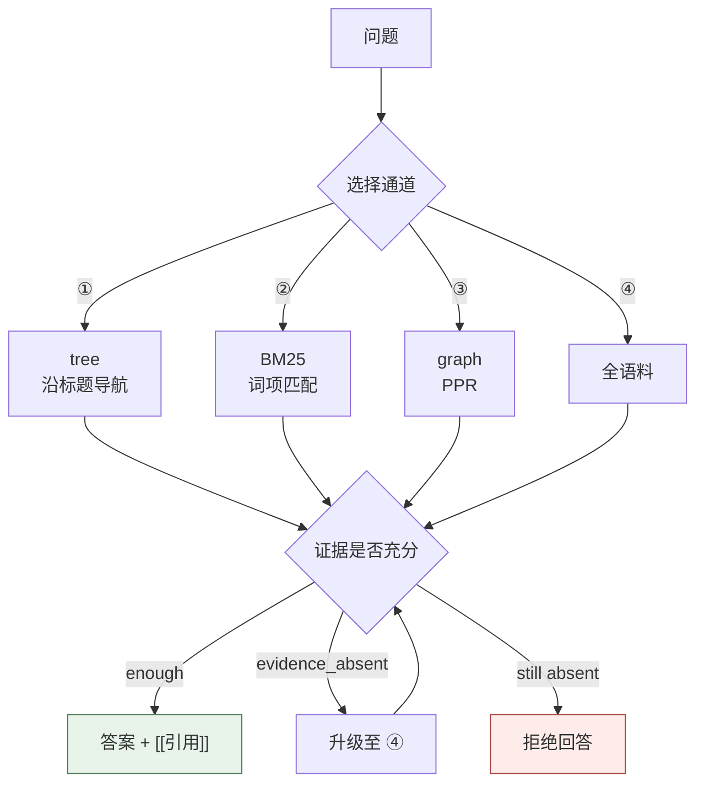
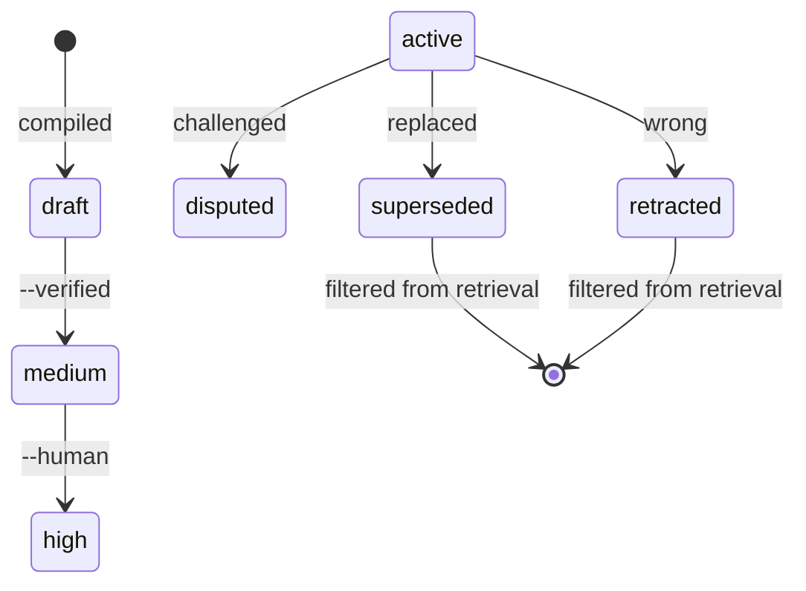

[](https://github.com/DeepTrial/KoiosBase/actions/workflows/ci.yml)
[](https://github.com/DeepTrial/KoiosBase/releases)
[](LICENSE)

中文 · [English](docs/i18n/README.en.md) · [Français](docs/i18n/README.fr.md) · [Español](docs/i18n/README.es.md) · [日本語](docs/i18n/README.ja.md) · [한국어](docs/i18n/README.ko.md)

# KoiosBase

以 Markdown 为事实来源的知识库。撰写 Markdown，由 KoiosBase 建立索引，
每条答案均可溯源至其所依据的原文块。

```console
$ koios search "revenue" -p myvault
[0] report.md#Financials/Revenue/1
    2024 Annual Report > Financials > Revenue
    ACME Corp revenue in 2024 was 3.2 billion yuan, up 12 percent.
[1] sources/report.md#2024 Annual Report/覆盖章节/1
    2024 Annual Report > 2024 Annual Report > 覆盖章节
    - Financials (`report.md#Financials`) - Revenue (`report.md#Financials/Revenue`) - Cash Flow (`report.md#Finan
[2] sources/report.md#2024 Annual Report/本文档能回答的问题/1
    2024 Annual Report > 2024 Annual Report > 本文档能回答的问题
    - 关于「Financials」，本文档有哪些说明？ (report.md#Financials) - 关于「Revenue」，本文档有哪些说明？ (report.md#Financials/Revenue) - 关于「
[3] sources/report.md#2024 Annual Report/导读摘要/1
    2024 Annual Report > 2024 Annual Report > 导读摘要
    ACME Corp revenue in 2024 was 3. 2 billion yuan, up 12 percent. Operating cash flow was positive for the year.
```

- **Markdown 为唯一事实来源。** 索引属于构建产物，可随时删除并原样重建。
- **知识具备生命周期。** 某个块被 retract 后，引用该块的页面全部标记 stale，不再参与作答。



## 安装

单个 Rust 二进制，无运行时依赖。

```bash
curl -LO https://github.com/DeepTrial/KoiosBase/releases/latest/download/koios-linux-x86_64
chmod +x koios-linux-x86_64
# 或从源码构建（MuPDF 的 bindgen 需要 libclang）
git clone https://github.com/DeepTrial/KoiosBase && cd KoiosBase
cargo build --release --manifest-path rust-cli/Cargo.toml
```

```console
$ koios init demo && koios index demo && koios lint demo
initialized KoiosBase vault at demo
indexed 0 blocks from demo
---- lint: 0 finding(s)
```

### 接入模型（可选）

未配置模型时 KoiosBase 仍可正常使用：内置生成器仅输出带引用的检索块，
不生成原文以外的内容。

如需接入，执行 `koios config --init -p myvault` 生成带注释的 `koios.toml`，
修改其中的配置项：

```toml
[model]
kind = "openai"                          # 协议类型，取值见下表
base_url = "https://api.openai.com/v1"
model = "gpt-4o-mini"
api_key_env = "OPENAI_API_KEY"           # 环境变量名称，而非密钥本身
```

配置文件就绪后，`koios query` 将直接使用该模型，无需附加参数。`kind` 仅有
两个取值，决定请求所用的协议：

| `kind` | 请求端点 | 答案读取位置 |
| --- | --- | --- |
| `openai`（默认） | `{base}/chat/completions` | `choices[0].message.content` |
| `anthropic` | `{base}/messages` | `content[0].text` |

`openai` 适用于所有兼容该协议的服务：OpenAI、Ollama、vLLM、llama.cpp、
DeepSeek、Moonshot、LiteLLM，以及代理 Claude 的网关——此类网关对外统一呈现
该协议格式，与其后端模型无关。仅当使用 Anthropic 自有端点时才需指定
`anthropic`。Gemini 与 Bedrock 当前未适配，可通过下述 `--llm-cmd` 或由网关
转换协议解决。

若仅临时试用、不希望修改配置文件，可使用 `--llm-cmd`，其优先级高于
`koios.toml` 中的配置：

```console
$ koios query "revenue" -p myvault --llm-cmd 'printf "%s" "Revenue was 3.2 billion yuan."'
verdict: enough  hits: 4  escalated: false
Revenue was 3.2 billion yuan.
[contracts] citation=0/1 sentences cited
```

模型输出同样受引用契约约束。缺失引用将被记录并报告，而非静默通过；模型调用
失败时返回错误，不会以生成内容替代。上例即因未携带引用而被标记。

## 用法

```console
$ koios init myvault                            # 初始化 vault
$ koios index myvault                           # 每次修改 raw/ 后执行
$ koios search "revenue" -p myvault             # 检索
$ koios query  "revenue" -p myvault             # 完整管线 + verdict
verdict: enough  hits: 4  escalated: false
[0] report.md#Financials/Revenue/1
    ACME Corp revenue in 2024 was 3.2 billion yuan, up 12 percent.
[1] sources/report.md#2024 Annual Report/覆盖章节/1
    - Financials (`report.md#Financials`)
- Revenue (`report.md#Financials/Revenue`)
- Cash Flow (`report.md#Finan
[2] sources/report.md#2024 Annual Report/本文档能回答的问题/1
    - 关于「Financials」，本文档有哪些说明？ (report.md#Financials)
- 关于「Revenue」，本文档有哪些说明？ (report.md#Financials/Revenue)
- 关于「
[3] sources/report.md#2024 Annual Report/导读摘要/1
    ACME Corp revenue in 2024 was 3. 2 billion yuan, up 12 percent. Operating cash flow was positive for the year.
$ koios compile -p myvault                      # 编译结构化页面
compiled: entities=2 entity_pages=2 source_pages=1 affected_pages=5 refreshed=0 stamp=2026-10-12
$ koios studio brief -p myvault -t revenue      # 导出
wrote myvault/wiki/synthesis/brief-revenue.md
$ koios mcp --install codex                     # 注册到 MCP 宿主
```

检索按问题选择通道，并在作答前判定证据是否充分：



**ACL**：`--groups finance-team` 用于指定调用方所属分组。未指定时为匿名身份，
受 ACL 限制的文档对该调用方不可见，此为预期行为。

> **信任边界**：`groups` 是调用方**自称**的，KoiosBase 不做任何认证或鉴权。
> 任何能调用 CLI 或 MCP 的人都可以任意指定分组。因此 KoiosBase 必须部署在
> 你已授权的主体之后（本机 shell、受控的 agent 宿主），**不要**直接暴露给浏览器
> 或网络节点。ACL 的作用是限制已授权主体之间的可见性，不是身份认证层。

**vault 目录结构**：`raw/` 为撰写的原始文档，`wiki/` 为生成的编译页面（建议提交），
`.index/` 为构建产物（不应提交）。

## 维护

| 操作 | 命令 |
| --- | --- |
| 修改 `raw/` 之后 | `koios index myvault` |
| 健康检查 | `koios lint myvault` |
| 版本升级之后 | `koios index myvault --full` |
| 备份 | `koios backup -p myvault -o /backups` |
| 恢复 | `koios restore <archive> -o /path`（拒绝写入非空目录） |

## 评测

用 MIRACL-zh 复现召回指标（需要先准备数据，见脚本头注释）：

```console
$ python3 tools/eval_miracl.py --koios rust-cli/target/release/koios \
      --data /tmp/miracl --model-dir /path/to/models --json out.json
docs=362 gold=62 queries=40 coverage=1.000
indexed in 522.5s
default (all layers): hit@1=0.950  hit@5=1.000
layer=raw          : hit@1=0.950  hit@5=1.000
raw-vs-all:  hit@1=+0.000  hit@5=+0.000
```

脚本会在出分前**校验 gold 段落确实在语料内**（`coverage=1.000`），覆盖不全则拒绝
报数。这道检查是必须的：曾经因为只下载了部分分片、103 个 gold 里有 56 个不在库内，
把"答案不存在"计成了"检索失败"，得出 hit@1 0.700 的错误结论——修正后是 0.950。
`layer=raw` 与默认一致即说明派生页未挤占原文（§4.3）。

**并发**：`koios index` 用 `.index/index.lock` 互斥——两个进程同时重建同一个 vault
此前没有任何保证。持有者进程若已退出，锁会被自动回收，所以一次中断不会把 vault
永久锁死。长驻 MCP 与 `index` 可以同时运行，但同一时刻只会有一个 index 在写。
| 修正错误事实 | `koios retract -p myvault -b "块id" --reason "..."` |
| 提升置信度 | `koios promote --human-confirmed "wiki/entities/acme.md"` |

```console
$ koios retract -p myvault -b "report.md#Financials/Revenue/1" --reason "wrong figure"
retracted report.md#Financials/Revenue/1; affected pages: 3 ["entities/acme-corp.md", "entities/acme.md", "synthesis/brief-revenue.md"]
```



置信度仅依据生成器之外的证据提升（§5.4，不按引用数量计）：`draft → medium → high`。

## 文档

- `docs/KoiosBase设计文档v1.3.md` —— 设计基线
- `docs/python-rust-parity.md` —— 移植审计轨迹
- `docs/known-gaps.md` —— 已知限制
- `docs/i18n.md` —— 翻译规范
- `AGENTS.md` —— 写入每个 vault 的维护契约

MIT —— 见 [LICENSE](LICENSE)。
