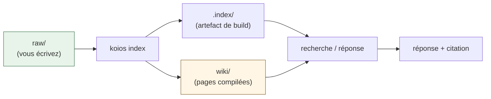
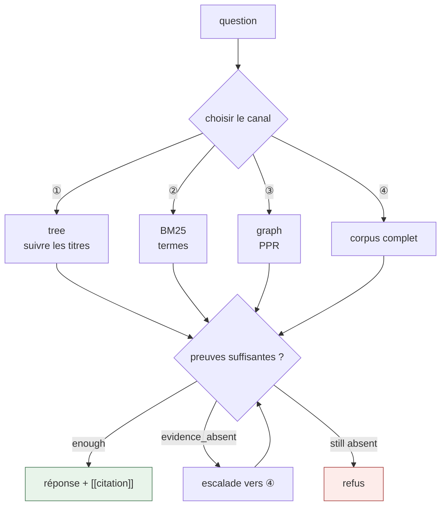
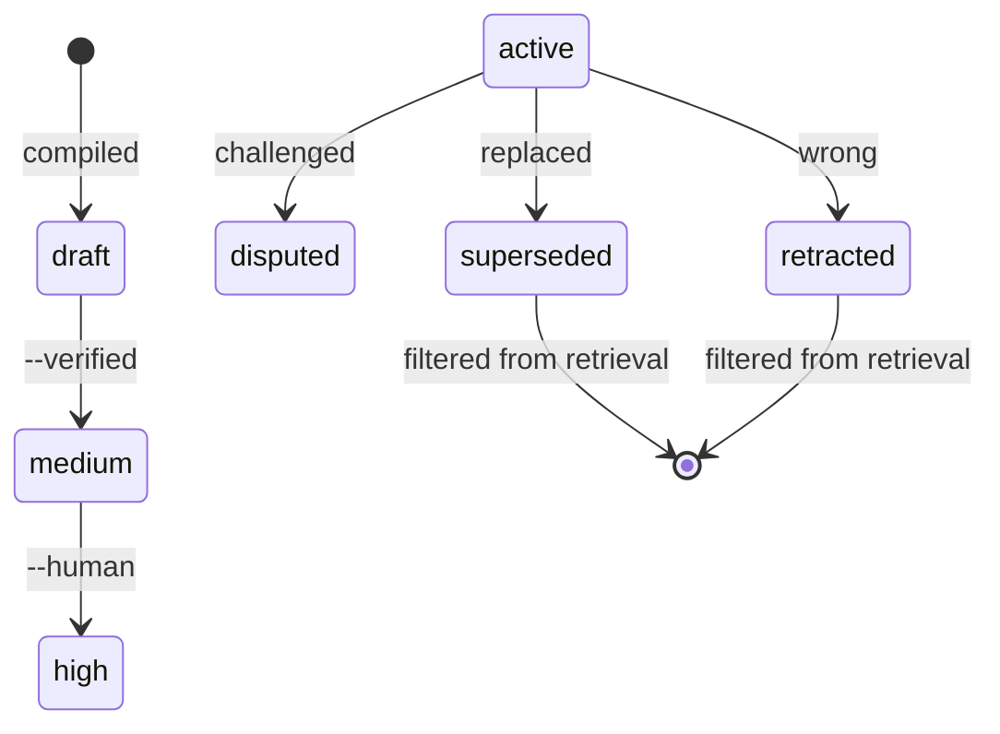

[](https://github.com/DeepTrial/KoiosBase/actions/workflows/ci.yml)
[](https://github.com/DeepTrial/KoiosBase/releases)
[](../../LICENSE)

[中文](../../README.md) | [English](README.en.md) | [Français](README.fr.md) | [Español](README.es.md) | [日本語](README.ja.md) | [한국어](README.ko.md)

# KoiosBase

Base de connaissances qui considère le Markdown comme source de vérité. Vous
rédigez du Markdown, KoiosBase l'indexe, et chaque réponse renvoie au bloc dont
elle provient.

```console
$ koios search "revenue" -p myvault
[0] report.md#Financials/Revenue/1
    2024 Annual Report > Financials > Revenue
    ACME Corp revenue in 2024 was 3.2 billion yuan, up 12 percent.
[1] sources/report.md#2024 Annual Report/覆盖章节/1
    2024 Annual Report > 2024 Annual Report > 覆盖章节
    - Financials (`report.md#Financials`) - Revenue (`report.md#Financials/Revenue`) - Cash Flow (`report.md#Finan
[2] sources/report.md#2024 Annual Report/本文档能回答的问题/1
    2024 Annual Report > 2024 Annual Report > 本文档能回答的问题
    - 关于「Financials」，本文档有哪些说明？ (report.md#Financials) - 关于「Revenue」，本文档有哪些说明？ (report.md#Financials/Revenue) - 关于「
[3] sources/report.md#2024 Annual Report/导读摘要/1
    2024 Annual Report > 2024 Annual Report > 导读摘要
    ACME Corp revenue in 2024 was 3. 2 billion yuan, up 12 percent. Operating cash flow was positive for the year.
```

- **Le Markdown est ce qui compte.** L'index peut être supprimé à tout moment et
  il se reconstruit à l'identique.
- **La connaissance devient obsolète.** Rétractez un bloc et toutes les pages qui
  le citent sont marquées obsolètes et cessent de répondre.



## Installation

Un seul binaire Rust, sans dépendance à l'exécution.

```bash
curl -LO https://github.com/DeepTrial/KoiosBase/releases/latest/download/koios-linux-x86_64
chmod +x koios-linux-x86_64
# ou compilation depuis les sources (le bindgen de MuPDF nécessite libclang)
git clone https://github.com/DeepTrial/KoiosBase && cd KoiosBase
cargo build --release --manifest-path rust-cli/Cargo.toml
```

```console
$ koios init demo && koios index demo && koios lint demo
initialized KoiosBase vault at demo
indexed 0 blocks from demo
---- lint: 0 finding(s)
```

### Brancher un modèle (optionnel)

KoiosBase fonctionne sans modèle. Le générateur intégré renvoie alors les blocs
retrouvés avec leurs citations, sans rien ajouter au-delà du texte source.

Pour en brancher un, exécutez `koios config --init -p myvault`. La commande
écrit un `koios.toml` commenté ; il suffit d'en modifier les champs utiles :

```toml
[model]
kind = "openai"                          # protocole ; voir le tableau ci-dessous
base_url = "https://api.openai.com/v1"
model = "gpt-4o-mini"
api_key_env = "OPENAI_API_KEY"           # le NOM de la variable d'environnement, jamais la clé
```

Une fois ce fichier en place, `koios query` utilise le modèle sans option
supplémentaire. `kind` n'accepte que deux valeurs et sélectionne le protocole de
requête :

| `kind` | endpoint | réponse lue depuis |
| --- | --- | --- |
| `openai` (par défaut) | `{base}/chat/completions` | `choices[0].message.content` |
| `anthropic` | `{base}/messages` | `content[0].text` |

`openai` s'applique à tout service parlant ce protocole : OpenAI, Ollama, vLLM,
llama.cpp, DeepSeek, Moonshot, LiteLLM, ainsi que les passerelles qui proxifient
Claude — celles-ci exposent cette même forme quel que soit le modèle derrière.
`anthropic` n'est nécessaire que pour l'endpoint propre à Anthropic. Gemini et
Bedrock ne sont pas couverts ; utilisez `--llm-cmd` ci-dessous, ou une
passerelle qui traduit pour vous.

Pour un essai ponctuel sans modifier le fichier de configuration, `--llm-cmd`
prend la priorité sur `koios.toml` :

```console
$ koios query "revenue" -p myvault --llm-cmd 'printf "%s" "Revenue was 3.2 billion yuan."'
verdict: enough  hits: 4  escalated: false
Revenue was 3.2 billion yuan.
[contracts] citation=0/1 sentences cited
```

Les contrats de citation s'appliquent également à la sortie du modèle. Une
citation manquante est consignée et signalée au lieu d'être ignorée, et un appel
en échec renvoie une erreur au lieu de substituer un texte généré. L'exemple
ci-dessus est signalé précisément parce qu'il ne porte aucune citation.

## Utilisation

```console
$ koios init myvault                            # créer un vault
$ koios index myvault                           # après chaque édition de raw/
$ koios search "revenue" -p myvault             # rechercher
$ koios query  "revenue" -p myvault             # pipeline complet + verdict
verdict: enough  hits: 4  escalated: false
[0] report.md#Financials/Revenue/1
    ACME Corp revenue in 2024 was 3.2 billion yuan, up 12 percent.
[1] sources/report.md#2024 Annual Report/覆盖章节/1
    - Financials (`report.md#Financials`)
- Revenue (`report.md#Financials/Revenue`)
- Cash Flow (`report.md#Finan
[2] sources/report.md#2024 Annual Report/本文档能回答的问题/1
    - 关于「Financials」，本文档有哪些说明？ (report.md#Financials)
- 关于「Revenue」，本文档有哪些说明？ (report.md#Financials/Revenue)
- 关于「
[3] sources/report.md#2024 Annual Report/导读摘要/1
    ACME Corp revenue in 2024 was 3. 2 billion yuan, up 12 percent. Operating cash flow was positive for the year.
$ koios compile -p myvault                      # compiler les pages structurées
compiled: entities=2 entity_pages=2 source_pages=1 affected_pages=5 refreshed=0 stamp=2026-10-12
$ koios studio brief -p myvault -t revenue      # exporter
wrote myvault/wiki/synthesis/brief-revenue.md
$ koios mcp --install codex                     # enregistrer auprès d'un hôte MCP
```

La recherche choisit un canal par question et détermine si les preuves sont
suffisantes avant de répondre :



**ACL** : `--groups finance-team` déclare le groupe de l'appelant. Sans cette
option, l'appelant est anonyme et les documents restreints par ACL restent
invisibles. C'est le comportement attendu.

**Structure du vault** : `raw/` contient ce que vous écrivez, `wiki/` les pages
générées (à commiter), `.index/` un artefact de build (à ne pas commiter).

## Maintenance

| Tâche | Commande |
| --- | --- |
| Après édition de `raw/` | `koios index myvault` |
| Contrôle de santé | `koios lint myvault` |
| Après montée de version | `koios index myvault --full` |
| Un fait est erroné | `koios retract -p myvault -b "identifiant-du-bloc" --reason "..."` |
| Élever la confiance | `koios promote --human-confirmed "wiki/entities/acme.md"` |

```console
$ koios retract -p myvault -b "report.md#Financials/Revenue/1" --reason "wrong figure"
retracted report.md#Financials/Revenue/1; affected pages: 3 ["entities/acme-corp.md", "entities/acme.md", "synthesis/brief-revenue.md"]
```



La confiance ne monte que sur des preuves extérieures au générateur (§5.4 —
jamais en comptant les citations) : `draft → medium → high`.

## Documentation

- `docs/KoiosBase设计文档v1.3.md` — référence de conception
- `docs/python-rust-parity.md` — piste d'audit du portage
- `docs/known-gaps.md` — limites connues
- `docs/i18n.md` — convention de traduction
- `AGENTS.md` — le contrat écrit dans chaque vault

MIT — voir [LICENSE](../../LICENSE).
