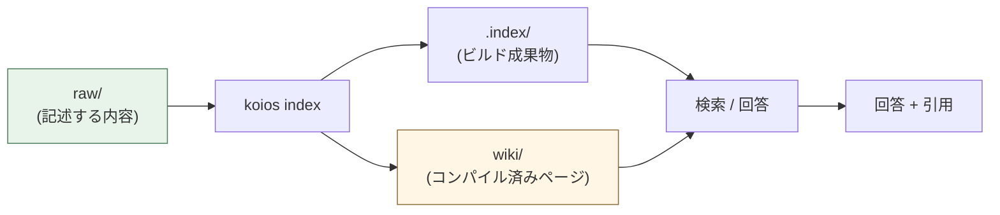
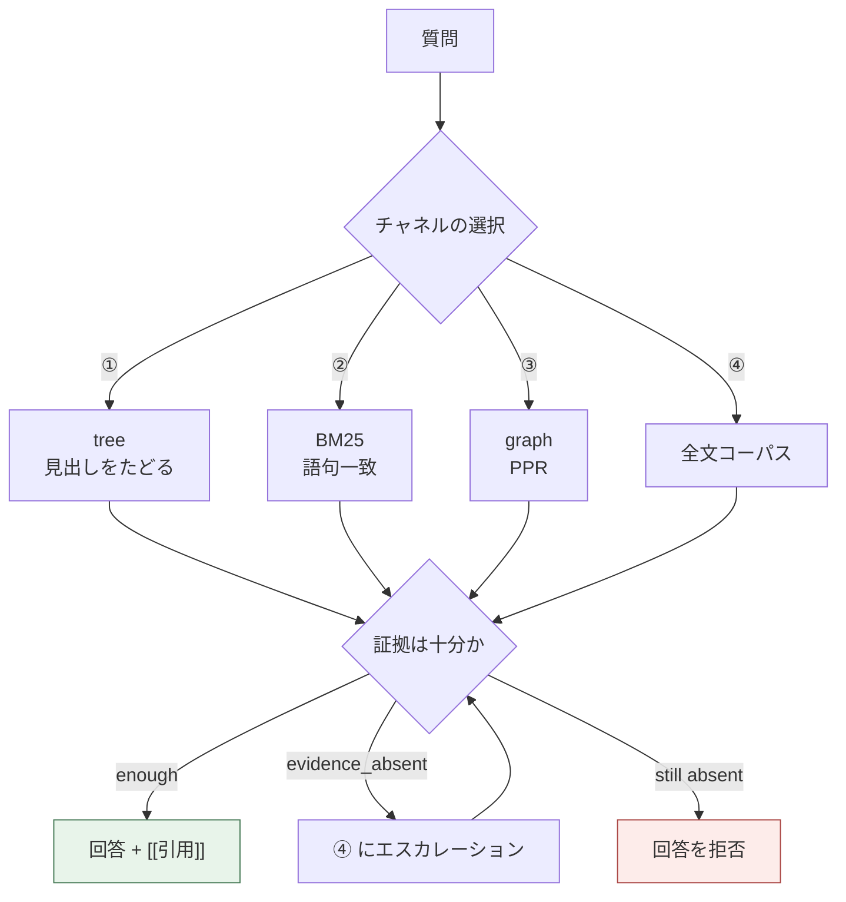
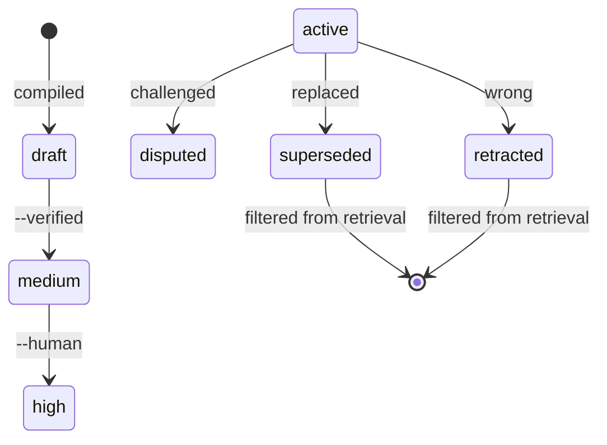

[](https://github.com/DeepTrial/KoiosBase/actions/workflows/ci.yml)
[](https://github.com/DeepTrial/KoiosBase/releases)
[](../../LICENSE)

[中文](../../README.md) · [English](README.en.md) · [Français](README.fr.md) · [Español](README.es.md) · 日本語 · [한국어](README.ko.md)

# KoiosBase

Markdown を信頼できる情報源として扱うナレッジベースです。Markdown を記述すると
KoiosBase がインデックスを作成し、すべての回答はその根拠となったブロックを
指し示します。

```console
$ koios search "revenue" -p myvault
[0] report.md#Financials/Revenue/1
    2024 Annual Report > Financials > Revenue
    ACME Corp revenue in 2024 was 3.2 billion yuan, up 12 percent.
[1] sources/report.md#2024 Annual Report/覆盖章节/1
    2024 Annual Report > 2024 Annual Report > 覆盖章节
    - Financials (`report.md#Financials`) - Revenue (`report.md#Financials/Revenue`) - Cash Flow (`report.md#Finan
[2] sources/report.md#2024 Annual Report/本文档能回答的问题/1
    2024 Annual Report > 2024 Annual Report > 本文档能回答的问题
    - 关于「Financials」，本文档有哪些说明？ (report.md#Financials) - 关于「Revenue」，本文档有哪些说明？ (report.md#Financials/Revenue) - 关于「
[3] sources/report.md#2024 Annual Report/导读摘要/1
    2024 Annual Report > 2024 Annual Report > 导读摘要
    ACME Corp revenue in 2024 was 3. 2 billion yuan, up 12 percent. Operating cash flow was positive for the year.
```

- **Markdown が本体です。** インデックスはビルド成果物であり、いつでも削除
  でき、再構築すれば同一の内容が復元されます。
- **知識には寿命があります。** ブロックを retract すると、そのブロックを引用
  しているページはすべて stale となり、回答に使用されなくなります。



## インストール

単一の Rust バイナリです。実行時の依存関係はありません。

```bash
curl -LO https://github.com/DeepTrial/KoiosBase/releases/latest/download/koios-linux-x86_64
chmod +x koios-linux-x86_64
# またはソースからビルド（MuPDF の bindgen には libclang が必要）
git clone https://github.com/DeepTrial/KoiosBase && cd KoiosBase
cargo build --release --manifest-path rust-cli/Cargo.toml
```

```console
$ koios init demo && koios index demo && koios lint demo
initialized KoiosBase vault at demo
indexed 0 blocks from demo
---- lint: 0 finding(s)
```

### モデルの接続（任意）

モデルがなくても動作します。その場合、内蔵ジェネレーターは取得したブロックを
引用付きで返すのみで、原文に存在しない内容を追加することはありません。

モデルを接続する場合は `koios config --init -p myvault` を実行します。コメント
付きの `koios.toml` が生成されるので、必要な項目を編集してください：

```toml
[model]
kind = "openai"                          # プロトコル（下記の表を参照）
base_url = "https://api.openai.com/v1"
model = "gpt-4o-mini"
api_key_env = "OPENAI_API_KEY"           # 環境変数の「名前」。キー自体ではない
```

このファイルが配置されていれば、`koios query` は追加のオプションなしでモデルを
使用します。`kind` は 2 種類のみで、リクエストのプロトコルを決定します：

| `kind` | エンドポイント | 回答の読み出し元 |
| --- | --- | --- |
| `openai`（既定） | `{base}/chat/completions` | `choices[0].message.content` |
| `anthropic` | `{base}/messages` | `content[0].text` |

`openai` はこのプロトコルに対応するすべてのサービスに適用できます：OpenAI、
Ollama、vLLM、llama.cpp、DeepSeek、Moonshot、LiteLLM、および Claude を
プロキシするゲートウェイ（これらは背後のモデルにかかわらず同じ形式を外部に
公開します）。`anthropic` が必要なのは Anthropic 自身のエンドポイントのみです。
Gemini と Bedrock は対応していません。後述の `--llm-cmd` を使用するか、
ゲートウェイに変換させてください。

設定ファイルを変更せずに一度だけ試す場合は、`--llm-cmd` が `koios.toml` より
優先されます：

```console
$ koios query "revenue" -p myvault --llm-cmd 'printf "%s" "Revenue was 3.2 billion yuan."'
verdict: enough  hits: 4  escalated: false
Revenue was 3.2 billion yuan.
[contracts] citation=0/1 sentences cited
```

引用契約はモデルの出力にも適用されます。引用が欠けている場合は見過ごされず
記録・報告され、呼び出しが失敗した場合は生成テキストで置き換えるのではなく
エラーを返します。上記の例は、引用をまったく含んでいないため指摘されています。

## 使い方

```console
$ koios init myvault                            # vault を作成
$ koios index myvault                           # raw/ を編集するたびに実行
$ koios search "revenue" -p myvault             # 検索
$ koios query  "revenue" -p myvault             # 完全なパイプライン + verdict
verdict: enough  hits: 4  escalated: false
[0] report.md#Financials/Revenue/1
    ACME Corp revenue in 2024 was 3.2 billion yuan, up 12 percent.
[1] sources/report.md#2024 Annual Report/覆盖章节/1
    - Financials (`report.md#Financials`)
- Revenue (`report.md#Financials/Revenue`)
- Cash Flow (`report.md#Finan
[2] sources/report.md#2024 Annual Report/本文档能回答的问题/1
    - 关于「Financials」，本文档有哪些说明？ (report.md#Financials)
- 关于「Revenue」，本文档有哪些说明？ (report.md#Financials/Revenue)
- 关于「
[3] sources/report.md#2024 Annual Report/导读摘要/1
    ACME Corp revenue in 2024 was 3. 2 billion yuan, up 12 percent. Operating cash flow was positive for the year.
$ koios compile -p myvault                      # 構造化ページをコンパイル
compiled: entities=2 entity_pages=2 source_pages=1 affected_pages=5 refreshed=0 stamp=2026-10-12
$ koios studio brief -p myvault -t revenue      # エクスポート
wrote myvault/wiki/synthesis/brief-revenue.md
$ koios mcp --install codex                     # MCP ホストに登録
```

検索は質問ごとにチャネルを選択し、回答前に証拠が十分かどうかを判定します：



**ACL**：`--groups finance-team` は呼び出し元のグループを宣言します。指定しない
場合、呼び出し元は匿名となり、ACL で制限されたドキュメントは参照できません。
これは仕様どおりの動作です。

**vault の構成**：`raw/` は記述したドキュメント、`wiki/` は生成されたページ
（コミットを推奨）、`.index/` はビルド成果物（コミットしないでください）。

## 保守

| 作業 | コマンド |
| --- | --- |
| `raw/` の編集後 | `koios index myvault` |
| 状態確認 | `koios lint myvault` |
| バージョン更新後 | `koios index myvault --full` |
| 事実の誤りを訂正 | `koios retract -p myvault -b "ブロック ID" --reason "..."` |
| 信頼度を上げる | `koios promote --human-confirmed "wiki/entities/acme.md"` |

```console
$ koios retract -p myvault -b "report.md#Financials/Revenue/1" --reason "wrong figure"
retracted report.md#Financials/Revenue/1; affected pages: 3 ["entities/acme-corp.md", "entities/acme.md", "synthesis/brief-revenue.md"]
```



信頼度は、ジェネレーターの外部にある証拠によってのみ上がります（§5.4 —
引用の数は基準にしません）：`draft → medium → high`。

## ドキュメント

- `docs/KoiosBase设计文档v1.3.md` —— 設計の基準
- `docs/python-rust-parity.md` —— 移植の監査記録
- `docs/known-gaps.md` —— 既知の制限
- `docs/i18n.md` —— 翻訳の規約
- `AGENTS.md` —— 各 vault に書き込まれる契約

MIT —— [LICENSE](../../LICENSE) を参照してください。
